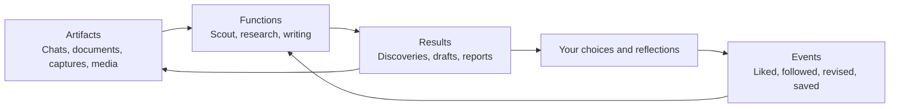

# Ghost architecture decisions

Original chat: Review Ghost architecture docs  
Conversation ID: `01a18987-a46f-7730-a683-5716e21c9a44`  
Date: October 29, 2026 (America/Los_Angeles)  
Coverage: From the opening architecture review request through the request to save this chat and organize the repo at 15:59:08.868 PDT.

This transcript preserves the original user messages and assistant replies, including visible progress updates, in their original order. Message wording, spelling, whitespace within messages, and links have not been edited. System/developer instructions, injected app/environment context, internal reasoning, and tool calls/results are excluded. This is a snapshot of an ongoing conversation; work and discussion after the stated cutoff are not included.

Earlier proposals appear alongside later corrections. This transcript records the conversation; its contents are not all current decisions or instructions.

> π: This transcript now lives in `events/chats/`; original message links are preserved.

---

## 01. User

*2026-10-29T14:19:35.188-07:00 (America/Los_Angeles)*

ok, check out the ghost architecture doc and the AI chat doc in this repo and let's flesh out a good architecture and approach to this ghost project. 


---

## 02. Assistant

*2026-10-29T14:19:37.511-07:00 (America/Los_Angeles)*

I’ll read the architecture and AI chat docs, then use the repo context to flesh out the design and implementation approach.


---

## 03. Assistant

*2026-10-29T14:20:04.592-07:00 (America/Los_Angeles)*

The latest part of the chat gives us a clear direction: a shared folder of readable records, with Scout as the first useful function.

The key design issue is preserving who expressed what. Your words, captured material, and AI outputs can live together, but Scout must distinguish them to learn from your choices. I’m working that into the proposal alongside positive-only feedback and a minimal first implementation.


---

## 04. Assistant

*2026-10-29T14:21:08.641-07:00 (America/Los_Angeles)*

I read both docs, including the full AI conversation. **I think Ghost should be a personal workspace that every AI task can read from and contribute to.** Your latest direction—ordinary files, existing tools, very little custom software—is the foundation I’d keep.

The important architectural work is deciding what those files mean and how an AI uses them.

**1. Keep your three concepts: artifacts, events, and functions.**

They describe different parts of one loop:



An **artifact** is something we can examine. An **event** records something that happened to or around it. A **function** describes work the AI should do using that history.

For example: a post is an artifact; your liking it is an event; Scout is a function. Scout’s recommendation becomes another artifact, and your response becomes new evidence.

One useful addition is **a record of each function run**: what it was trying to do, which evidence it used, and what it produced. That makes its behavior inspectable and gives future runs continuity.

**2. Make a small shared convention the foundation.**

I’d start with this organization, creating directories only as they become useful:

```text
ghost/
  ghost architecture.md
  artifacts/
    chats/
    captures/
    projects/
  events/
    2026-10-29/
  functions/
    scout.md
  runs/
    scout/
  memory/
```

These folders organize storage. Every function can retrieve evidence across them.

Markdown carries readable content and a little metadata. Images, recordings, and project files retain their original formats alongside it. A video’s Markdown file points to its source footage, editing instructions, project or transformation recipe, and outputs.

For automatically captured records, preserve:

| Information | Why it matters |
|---|---|
| Stable ID and source identity | Re-importing something shouldn’t create duplicate evidence. |
| When it happened and when it was captured | An old chat imported today is still old evidence. |
| Speaker, author, or actor | Your words and an assistant’s suggestions have different meanings. |
| Related records | Connect a reflection to a screenshot, or a revision to its conversation. |
| Original content and source references | Let future interpretations return to the evidence. |

Handwritten notes shouldn’t require filling out a form. Unknown metadata can remain unknown.

**3. Separate what happened from what Ghost thinks it means.**

This is the most consequential rule.

> “You liked this post” is an observation.  
> “You appreciate people who reveal uncertainty while thinking” is an interpretation.

Both are valuable, but interpretations should cite their evidence and remain revisable. I’d put these in `memory/` as short, contextual notes—not attempt one definitive personality profile.

Likewise, a whole AI conversation cannot count as your expressed preference. Preserve speakers, quoted material, and the difference between exploring an idea and choosing it. **Saving this architecture proposal would establish that we considered it; your subsequent decisions establish what you endorse.**

For document changes, preserve meaningful versions and the conversation that explains them. Git can provide version history, but the accompanying record supplies authorship and intent. [Git documentation](https://git-scm.com/docs/git)

**4. Personalization initially happens through context selection.**

Each function should:

1. Read your current objective.
2. Find relevant original expressions, including examples from other domains.
3. Consult interpretations as pointers to that evidence.
4. Produce its result with traceable reasons.
5. Save the result and any subsequent choices.

A reflection about pacing in a video might help Scout find someone whose work has a similar sensibility. But enjoying someone’s writing doesn’t automatically mean you want to write like them. Connections should retain their context.

With this small collection, reading and searching files is sufficient. If retrieval becomes cumbersome, a rebuildable SQLite full-text index is a reasonable next step; the files remain authoritative. [SQLite FTS5 documentation](https://www.sqlite.org/fts5.html)

**5. Give Scout a precise job and a lightweight feedback loop.**

I’d define its job as:

> Find people whose actual work suggests a meaningful reason for me to connect with them.

Each run would read your current interests and positive evidence, explore outward through people’s work and references, and return **up to three people**. Each recommendation should include:

- Something specific they made.
- The expression of yours that motivated the connection.
- A concrete reason you might enjoy talking.
- What remains uncertain about the match.

Record previously surfaced people so Scout avoids repetition. Your deliberate likes and enthusiasm strengthen future exploration. Unacted-on recommendations can stop resurfacing without becoming evidence that you dislike an entire kind of person. Research on search interactions supports caution about interpreting engagement as an absolute preference; that expiration policy would be our design choice. [Joachims et al.](https://www.cs.cornell.edu/People/tj/publications/joachims_etal_07a.pdf)

There should be no required rejection queue. Feedback happens through the browsing and conversations you already want to have.

**The first implementation should complete that loop.**

The folder currently contains the architectural intent and conversation, but the original Taste captures described in the conversation aren’t present. Those would be the most useful next input.

I’d sequence the work as follows:

1. **Bring in the existing Taste captures**, preserving screenshots, reflections, and original identifiers.
2. **Write `functions/scout.md`** with the objective, evidence rules, research process, and output format.
3. **Run Scout manually**, save its evidence and recommendations, and capture your natural response.
4. **Repeat**, looking for discoveries you actually want to pursue.
5. **Automate the capture path whose absence most limits that loop.** Browser capture must retain your explicit, visible recording boundary.

The first milestone is concrete: **Ghost finds someone you want to meet, preserves why that recommendation worked, and uses that evidence in the next run.** That gives us a useful project immediately, while the same records and conventions can support writing, research, and creative work.

---

## 05. User

*2026-10-29T14:26:32.334-07:00 (America/Los_Angeles)*

ok this is good, but let's also hold back a bit on execution until we have a better understanding of how this system will work.

this matters bec this is the kind of system that can just blow up in complexity vv easily if we're not careful. i want to make sure we keep things as simple as possible, use existing tools wherever possible, minimize what we build, and basically set things up to compound really really well in terms of the value this unlocks.

let's be mindful and thoughtful. let's not get into the details of any specific function jsut yet (scout() is a function).

another thing to keep in mind is that i want to have chats with both you and other llm providers using this repo context. and so i also want to make sure there is a sort of "core process" that is established for this repo that ensures that chats anywhere are reflected in this repo.

ok so what i'm getting at is that i think we should think about things at the system design and schema level for a little bit without getting too carried away and premature optimizing thigns that don't matter yet


---

## 06. Assistant

*2026-10-29T14:27:29.275-07:00 (America/Los_Angeles)*

Agreed. I moved too quickly toward implementation. **The next thing to settle is the small set of rules that makes Ghost coherent across tools and over time.** The directories and extra layers in my previous proposal should stay provisional.

I think the central design question is:

> How can work happen through different tools and models, while leaving behind one understandable, trustworthy history that makes subsequent work better?

There are a few distinctions worth establishing now.

**1. Separate the historical record from our current understanding.**

The repo will contain both:

- **What happened:** conversations, captures, documents, revisions, observations.
- **What currently stands:** your present intentions, agreed decisions, and the current state of a project.

Those serve different purposes. The AI chat already illustrates this: you explored browsers, dedicated devices, Linux, and eventually a folder. A future model needs access to that exploration, but it also needs to understand where your thinking landed.

The historical record preserves nuance. Current documents provide orientation. Neither can fully replace the other.

This is also how we avoid having every new conversation repeat the entire architectural discussion.

**2. Treat artifacts, events, and functions as concepts—not necessarily separate infrastructure.**

An event can already be expressed inside an artifact. A chat message saying “I like this version; use it” records a choice. We don’t immediately need to extract that into a separate event file.

Similarly, a function can initially be described in an ordinary document. It doesn’t require a framework.

I’d use this principle:

> Preserve information in its natural form. Introduce an additional representation when it solves a demonstrated problem.

That keeps us from maintaining a transcript, extracted events, a preference profile, a summary, and a graph of the same conversation before we know which representations help.

**3. The common schema should preserve meaning, with very little ceremony.**

At the conceptual level, every record needs answers to a few questions:

| Question | What it preserves |
|---|---|
| What is this? | Its identity and readable content. |
| Where did it come from? | Original source and authorship. |
| When does it belong? | The time of the original activity, distinguished from later import. |
| What does it refer to? | Connections to other records and assets, where relevant. |

Different media can answer those differently. A chat needs speakers and message order; a screenshot needs the image and associated reflection; a document needs its content and meaningful revision history.

**We should standardize these meanings before standardizing every field.** Ordinary notes should remain easy to write. Capture tools can supply metadata automatically where available.

One rule does need to be universal: importing or summarizing something must preserve the distinction between your expression, someone else’s material, and an AI’s interpretation.

**4. Establish one core process for participating chats.**

I’d make the process itself a short, provider-neutral document in the repo. Its conceptual workflow would be:

**Orient → converse → preserve → reconcile.**

- **Orient:** Read the core process and the relevant current documents. Consult older evidence when useful.
- **Converse:** Explore freely. Suggestions remain suggestions until there is evidence that you adopted them.
- **Preserve:** Bring the actual conversation into Ghost, retaining speakers, sequence, and available attachments or references.
- **Reconcile:** Reflect settled decisions and resulting work in the relevant current documents, with a reference back to the conversation.

Preservation and reconciliation are separate operations. A conversation can be saved without changing our current understanding. An unresolved discussion can remain unresolved.

The provider-specific setup should merely point into this shared process wherever possible. We should avoid maintaining slightly different versions of “how Ghost works” for every model.

There is one practical limitation to keep explicit: **instructions establish the process; they don’t establish connectivity.** Each chat surface still needs a way to receive repo context and return its conversation. That might be native access, an existing export, or a manual handoff initially. A model-generated recollection shouldn’t silently substitute for the original transcript.

**5. Make compounding come from continuity.**

The useful cycle is:

> Experience leaves evidence → discussion develops understanding → decisions update current documents → subsequent work begins from that improved state.

That gives us two forms of accumulation: richer source material and a clearer present understanding. We don’t need to decide yet how much of that will eventually be automated.

There is also a boundary worth making explicit: archived conversations and captured webpages are material to examine. The current core process governs how the repo is used. Otherwise an old instruction, abandoned proposal, or quoted passage could accidentally govern future behavior.

For this design stage, I’d focus on **the core process, the distinction between history and current state, and the minimum information a record must preserve**. Then we can walk a few hypothetical conversations through those rules—across different providers, with changed decisions and attached media—and see where the design breaks before adding machinery.

---

## 07. User

*2026-10-29T14:53:29.474-07:00 (America/Los_Angeles)*

ok i'm a little lost. lot of information here. can we simplify?

like, let me just share perhaps how i'm looking at this. documents that i create in this repo will be artifacts that i own and back. like they will often capture key decisions that i've made about something, etc. even if i iterate on a doc with you in a chat, i will not let you just write to that doc (almost certainly) and i will be the one writing. i want to maintain this discipline so that we have a very clear demarcation between observations / things that you do, and what i have explicitly written down and back. and this is v healthy. once again, as complexity grows, it is very important for us to understand what is emergent / ai generated, and what is something that i have explicitly done.

but ok, let me step back for a second.

another thing that is coming to my mind right now is my workflow. like i have this repo open in my obsidian. i just enter obsidian, open a new tab and just start expressing whatever i feel like. organization is an emergent thing that you help me with, not something that i have to think about. like once we figure out an organization schema (dirs, subdirs, etc.) it would be your job to periodically (perhaps as a function!) sort my expressions into where they need to go. and for example: when chats are saved, they would go into the chats/ dir. when browsing sessions are saved, they go into browsing/, etc.

so in addition to the core entities, there is an organization structure here that we ought to have. right?


---

## 08. Assistant

*2026-10-29T14:53:53.519-07:00 (America/Los_Angeles)*

Yes. **You express freely; I help organize what accumulates.** The organization should support your workflow without becoming something you have to manage.

And your authorship boundary simplifies things considerably: **the documents you write are your own expressions.** I can discuss them with you, but my interpretations and outputs live separately. Saving an AI response doesn’t make it something you endorse.

A simple starting structure could be:

```text
ghost/
  new thought.md       ← you can start writing right here
  docs/                ← your documents
  chats/               ← conversations, with speakers preserved
  browsing/            ← browsing sessions and observations
  ai/                  ← AI-written summaries, proposals, outputs
  assets/              ← images, audio, video
```

This gives us two distinct things:

- **Entities describe what something is:** an artifact, an event, a function.
- **Folders give things a predictable home:** documents, chats, browsing sessions, AI outputs.

We don’t need every entity to have its own directory. A browsing session might contain many events; a chat is an artifact containing both your words and mine.

Your workflow stays exactly as you described: open Obsidian, create a note, express yourself. Later, an organizing function can place it appropriately, preserving your wording and keeping references working. Subfolders can emerge when there’s enough material to justify them.

The important rule is: **organizing your writing doesn’t authorize rewriting it.** Nor does moving or summarizing something turn AI-generated material into your own statement.

So yes—the organization structure belongs in the design. At this stage, a few predictable destinations and that clear authorship boundary may be most of the schema we need.

---

## 09. User

*2026-10-29T15:05:03.450-07:00 (America/Los_Angeles)*

great. i agree. keep things simple and only create new dir or whatever if absolutely warranted. and having well crafted readmes for each dir will greatly help us make sense of this.


but let's also spend some time here thinking about this high level organization.


what i see is:


- expression
- chats
- taste (like the screenshots + voice notes we've been capturing).
- events
  - browsing
  - ?
- ai
  - functions
  - skills?
  - scout/ (all scout reports come here - perhaps once a day or something - we figure it out later)
- assets (everything like videos, screenshots, audio files, etc.)


\----


wyt? let's align on this firstly


---

## 10. Assistant

*2026-10-29T15:05:28.510-07:00 (America/Los_Angeles)*

Yes—I think this is a good shape. It organizes things by recognizable parts of your life and workflow, without requiring an elaborate classification system.

```text
ghost/
  expression/
  chats/
  taste/
  events/
    browsing/
  ai/
    functions/
    scout/
  assets/
```

I’d give each a simple meaning:

| Directory | What belongs here |
|---|---|
| `expression/` | Things you author: thoughts, documents, decisions, project notes. |
| `chats/` | Conversations, preserving who said what. |
| `taste/` | Deliberate captures of things that resonate, together with your reflections. |
| `events/` | Observations of what happened: likes, follows, visits, and other activity. |
| `ai/` | AI outputs and the instructions defining what the AI does. |
| `assets/` | The underlying images, audio, videos, and other media referenced elsewhere. |

Three details seem worth aligning on:

**Taste is distinct from expression because it captures a particular relationship:** something you encountered, what you selected, and whatever you expressed about it. There’s conceptual overlap, but it’s a useful distinction in practice.

**Assets hold the media; the other folders hold its context.** A Taste entry links to its screenshot and voice recording. A document in `expression/` might link to a video you made. We don’t need duplicate copies of those assets.

**Under `ai/`, functions describe recurring work; folders like `scout/` hold its outputs.** I’d leave `skills/` undecided until we have a concrete need that `functions/` doesn’t cover.

Each directory’s README can explain its purpose, what belongs there, and any conventions that have actually become necessary. We can agree on those instructions together before saving them.

And this is a map of possible homes, **not a requirement to create every directory now**. You keep writing wherever it’s convenient; organization follows the material.

---

## 11. User

*2026-10-29T15:09:24.422-07:00 (America/Los_Angeles)*

ok interesting. just so we don't go off track, what is the purpose of this project? in one sharp sentence.


---

## 12. Assistant

*2026-10-29T15:09:31.695-07:00 (America/Los_Angeles)*

Ghost captures your expressions of taste in a shared, growing memory so any AI you work with can understand you and serve you better over time.

---

## 13. User

*2026-10-29T15:13:20.671-07:00 (America/Los_Angeles)*

ok i think we're done thinking about this high level organization. let's now think about the specific scout use case we have.


- track certain signals in the way i browse the web.
- use those signals + what i'm expressing + my taste capture - to surf the web (platforms, etc.) in the ways i do, and discover people i should connect with.
- put those recommendations in a report. and use implicit feedback (based on my further behavior abt whether i actually follow them / reach out to them, etc.) and explicit feedback ("oh great find, i really vibe iwth this person..." - and this will likely just go in taste! that's the thing, my taste capture will certainly reflect hwen i find someone or somethign i really vibe with).


right?


---

## 14. Assistant

*2026-10-29T15:13:35.893-07:00 (America/Los_Angeles)*

Yes. **Scout’s feedback comes through the same Ghost records you already create.**

The loop is:

1. **Observe:** Capture selected browsing signals—likes, follows, saves, and useful exploration trails—in `events/browsing/`.
2. **Explore:** Use those signals alongside `expression/` and `taste/` to discover people, following the sources and paths you naturally find fruitful.
3. **Recommend:** Save a report in `ai/scout/`, linking to people, their work, and why they might resonate with you.
4. **Learn from what follows:** Your subsequent browsing supplies behavioral signals; your enthusiasm and reflections flow into `taste/`. Both inform future recommendations.

The small connection we need to preserve is **which person and work each recommendation surfaced**, so later activity can be associated with it.

And one distinction remains important: following someone or expressing enthusiasm provides positive evidence; doing nothing leaves the match uncertain. Scout can avoid repeating an unanswered recommendation without concluding that you dislike similar people.

That’s a coherent loop—and it fits the organization we’ve already agreed on.

---

## 15. User

*2026-10-29T15:16:53.329-07:00 (America/Los_Angeles)*

yes. great. 

what is the shape of information we store? like in the browsing dir, is each browsing "session" a subdir and within it each signal gets its own md file?

actually yea this leads to a broader question about the formats we will use for these things.

one adv i see for keeping everything just folders and md is that i can operate on them the way i do anything else. for example: if there is a signal that i actually disagree with (for whatever reason!) i can literally just add the note in the md file for that! including reports that scouts generates.

initially i was thinking that maybe for events we do like a kv / some other efficient logging structure / products, but yea idk. from an end user (ME!) perspective, i sort of like having everything in text files basically. wyt?


---

## 16. Assistant

*2026-10-29T15:17:32.206-07:00 (America/Los_Angeles)*

Yes. **Your ability to read and annotate these records is a core feature of Ghost.** That’s a strong reason to make Markdown the primary format.

For browsing, I think your proposed shape works:

```text
events/
  browsing/
    2026-10-29-session-01/
      001-liked-a-post.md
      002-opened-an-author-profile.md
      003-followed-the-author.md
```

Each file represents a meaningful captured signal. The session folder preserves the surrounding sequence. We can decide what starts and ends a session when we design capture.

A signal file could be as simple as this illustrative example:

```markdown
# Liked a post by Alex

Time: 2026-10-29 15:42 -07:00
Source: [Original post](...)
Captured by: Browser recorder

## Observation

You liked this post:

> The captured text of the post.

## My notes

This was an accidental like. Don't treat it as interest.
```

The same idea works for a Scout report: the report contains the AI’s recommendations, and you can add your own reactions directly beside them.

**That means authorship needs to remain clear within a file, not just between directories.** A file in `ai/` can contain your annotations. A file in `events/` can contain an observed action and your explanation of it. Neither needs to move elsewhere to accommodate that.

I’d establish three simple rules:

- **Your annotations survive.** Re-importing an event or regenerating something must never silently overwrite your additions.
- **Your explanation governs interpretation.** The accidental like still happened, but your note tells Scout how to treat it.
- **The files remain authoritative.** If we eventually need faster search or querying, we can build an index from them. Your edits must flow through to whatever reads that index.

There’s also no need to duplicate your annotation into `taste/` just because it expresses a preference. Taste remains your dedicated capture workflow; meaningful expressions can occur throughout Ghost.

The main tradeoff is volume: one file per mouse movement would become cumbersome. But **one file per selected, meaningful signal** is a reasonable starting point for what we’re describing.

I’d start with folders, Markdown, and linked assets. A separate logging system becomes warranted only if we encounter a concrete limitation.

---

## 17. User

*2026-10-29T15:21:23.995-07:00 (America/Los_Angeles)*

great. and i completely agree. when we start to track everything i "see" in the browser, then ofc that would not make sense to have granular md files for everything there lol. we will evolve this as we grow. but the starting point is very clear. great.

what about tools? for ex, we will be creating a lightweight browser we control that i use and capture events. and scout() will likely also spin up its own browser (browserbase or something?) to surf the web. these are tools and services that are required to enable ghost. how do we think about them? i'm thinking they live outside of ghost/ - even those what tools we create and how we use them reflect my taste, the valuable parts of my taste will just be captured in my docs themselves! wyt?


---

## 18. Assistant

*2026-10-29T15:21:47.085-07:00 (America/Los_Angeles)*

Yes. **Ghost holds your personal record; tools and services operate on that record.** Keeping their implementations outside `ghost/` makes sense.

Something like:

```text
code/
  ghost/          ← expressions, captures, events, chats, AI outputs
  ghost-tools/    ← browser, collectors, Scout implementation, etc.
```

`ghost-tools/` is illustrative—we don’t need to decide how many code repos we’ll have yet.

The useful distinction is between **what a function should do** and **the machinery that executes it**:

- `ghost/ai/functions/scout.md` describes Scout’s purpose, the evidence it should consider, and how it should produce recommendations.
- The implementation lives elsewhere and uses whatever browser, model, or service we choose.
- Its reports and relevant observations come back into Ghost as ordinary files.

That gives tools a simple relationship with Ghost: **read the relevant context, do their work, and leave understandable records while preserving your annotations.** We should be able to replace a browser or model without changing the meaning of the accumulated material.

And I agree with your point about taste. Your reasons for building a browser a certain way, the choices you make, and your reactions to using it belong in your expressions and conversations. We don’t need to ingest the entire implementation merely because those decisions influenced it. When a particular piece of code matters as an expression, we can deliberately include or reference it.

So the boundary feels clean: **the durable personal material lives in Ghost; the software that helps capture and use it lives around Ghost.**

---

## 19. User

*2026-10-29T15:24:26.167-07:00 (America/Los_Angeles)*

ok is there anything else we should think through before diving into the details of this browser, the events we will capture, and setting up scout?

ok i guess there is. i want to understand the notion of agents / skills, etc. i'm a noob so i'm not really sure what all of this means. maybe let's actually not discuss this. let's just approach things naturally in a way that feels right to me. we can see if there are best practices we can adopt later (push back if you disagree!!).


---

## 20. Assistant

*2026-10-29T15:24:47.496-07:00 (America/Los_Angeles)*

I agree. **We have enough of the overall design to start working through concrete experiences.** You don’t need to learn an agents/skills framework first.

My only pushback: approaching this naturally should still include checking for existing tools when a specific need arises. We can borrow useful conventions without adopting an entire framework.

The remaining questions are practical, and we can answer them as we go:

- **Recording boundary:** When is the browser recording, what does it capture, and how do you pause it?
- **Reliable records:** How do captures and chats reach Ghost without getting lost, duplicated, or overwriting your notes?
- **Scout’s permissions:** What can it access and do online independently?

Those belong directly in the browser and Scout discussions. We don’t need another conceptual layer before tackling them.

I’d start with **what an ordinary browsing session should feel like for you**, then work backward to the smallest implementation that supports it.

---

## 21. User

*2026-10-29T15:29:30.239-07:00 (America/Los_Angeles)*

ok i actually have q.

so, i want to make ghost public. in the sense that not everything is immediately made public, we will have a process that lets us flag potentially sensitive / harmful things to publish, but basically i want to publish my personal data - at least for the short term - as an experiment. i think at this stage we have a lot more to gain than lose by being transparent. people can chime in on how we are doing things, use my data to train models etc. that i want to encourage if anyone wants to.

and there is a sort of presentation i have in mind. think of it as a stream of events that i "emit". with timestamps. i consumed x information, wrote y doc, browsed in z ways, captured k taste, etc. all of these are emitted in chronological order acc. to timestamp so that the data essentially shows how my mind "moves". there is a really cool presentation for this that can come later that is in my mind (imagine a real time continuous feed of a person's 'activity').

but given this "stream" is something that i want (not attached to when we make this happen) is there somethign more we should think through at the foundation level?

like, if i edit a doc right now, the timestamp of the edits is kind of lost because fs only stores last edited timestamp? unless we push to git / some versioning on a regular basis which then lets us track these. also, i would like control over this - i.e., i may edit a doc 100 times, but of those i may only consider 3 of those to be "versions" in the git sense. ya know?

idk, basically there is a diff betewen events and artifacts. and editing / working with artifacts also produces events. events have clear timestamps so it feels like everything is sort of already in place, but yea wondering how you see this?


---

## 22. Assistant

*2026-10-29T15:29:33.201-07:00 (America/Los_Angeles)*

I’ll check how version history fits this, then focus on what the future stream actually requires from the foundation.


---

## 23. Assistant

*2026-10-29T15:30:21.634-07:00 (America/Los_Angeles)*

Yes. **This adds one important requirement: a historical event should point to the artifact as it existed then, rather than whatever that file contains today.**

Three concepts make this straightforward:

| Concept | Example |
|---|---|
| **Artifact** | Your Ghost architecture document, throughout its life. |
| **Version** | A particular state of that document you chose to preserve. |
| **Event** | “At 3:42 pm, I recorded a new version of this document.” |

**You choose what counts as a version.**

You could edit a document 100 times and mark three meaningful checkpoints. Each checkpoint preserves the content and records a timestamped event. The stream could show the document at that point and the changes since its previous checkpoint.

Git could handle preserving those versions. A local commit records a snapshot; pushing is a separate operation that shares it with a remote. You don’t need to publish anything to preserve history. [Git commit](https://git-scm.com/docs/git-commit), [Git push](https://git-scm.com/docs/git-push)

One qualification: a checkpoint records when you made the checkpoint. It doesn’t recover when every individual edit happened. If we eventually want that finer history, we’d need to capture it as you work. Automatic recovery snapshots could also coexist with your deliberately chosen versions.

**The stream can then be a view across everything already in Ghost.**

For example:

```text
14:10  Liked a post
14:18  Captured a screenshot and reflection
14:45  Recorded version 2 of a document
15:02  Followed someone
15:30  Scout produced a report
```

These entries refer back to their records and relevant versions. We don’t need to reorganize everything into one giant chronological folder or create a second copy of all the content.

We should preserve stable identities so moving a document during organization doesn’t break its history. And the stream should retain who acted: “you followed someone” and “Scout generated a report” remain visibly different.

**Publication should be a separate step from recording a version.**

Marking a document version means “preserve this state.” It shouldn’t automatically mean “release this publicly.”

I’d publish a reviewed edition of Ghost, containing the material cleared by your publication process. That could itself be a public repository of Markdown and assets, with the feed as another way to experience it.

Clearance should apply to **the exact version and its accompanying assets**. Editing an already-public document introduces new material to evaluate. The public repository’s history also needs to contain only cleared material; removing something from the latest file doesn’t remove it from Git history. [GitHub’s explanation](https://docs.github.com/en/authentication/keeping-your-account-and-data-secure/removing-sensitive-data-from-a-repository)

Finally, preserve **when something happened separately from when it was published**. A reflection captured Monday and released Friday should still belong to Monday’s activity. Likewise, importing an older chat today shouldn’t make its conversation appear to have happened today.

Your control can stay simple: write freely, mark meaningful versions when you choose, and let the publication process operate independently. The eventual stream can build on those records without requiring us to build its presentation now.

---

## 24. User

*2026-10-29T15:33:01.030-07:00 (America/Los_Angeles)*

"If we eventually want that finer history, we’d need to capture it as you work" - we do not want that. i mean this only exists rn for the browsing, but i don't want all characters i typed to be sort of tracked. that's a bit much.

and re. the timestamps - exactly! reflection captured mondya released friday to a user shoudl still see the monday timestamp (and ofc somewhere we track when something was recorded and published, etc.)

ok, so it sounds like we are good on this front?


---

## 25. Assistant

*2026-10-29T15:33:09.721-07:00 (America/Los_Angeles)*

Yes—we’re good on this front. And understood: **no keystroke or individual-edit tracking.**

The agreed rules are:

- **Documents:** Preserve only the meaningful versions you deliberately mark.
- **Browsing:** Capture the selected signals we agree on.
- **History:** Events reference the relevant artifact version, so later edits don’t change what an earlier event points to.
- **Timestamps:** Display when the activity happened; separately retain when it was recorded and published.
- **Publication:** Recording something and clearing it for public release are separate steps.

That’s enough foundation for the stream. We can move into the browser experience and capture choices.

---

## 26. User

*2026-10-29T15:35:26.966-07:00 (America/Los_Angeles)*

ok for the browser, let's just start with:


- url open
- for social platforms (x is all i need for now): track post likes, user follows, open following list, click following url (so that we have a sense of who we discovered from who! - this will be useful down the line i think).


and that's it? anything else you think is useful?


and tbc: we will NEVER track unfollows and stuff like that. that information should not be an explicit event. i don't want to capture negative actions. 


---

## 27. Assistant

*2026-10-29T15:35:54.775-07:00 (America/Los_Angeles)*

Yes—that’s enough for the first version. **I’d add context to those signals, rather than expand the behaviors we capture.**

The useful information is:

| Action | Context to preserve |
|---|---|
| Open a URL | Destination and the page you came from, when known. |
| Like an X post | Post permalink, author, and post content at that moment. |
| Follow an X user | The account and where you initiated the follow. |
| Open someone’s following list | Whose list you opened. |
| Open a profile from that list | Whose list it came from and which person you selected. |

That last connection gives us something valuable:

```text
Opened Alex’s profile
→ Opened Alex’s following list
→ Opened Sam’s profile from that list
→ Followed Sam
```

We preserve the actual path without assuming why you took it. Following-list navigation can simply be a URL-open record with that additional context attached.

Two rules I’d establish:

- **“Opened” means opened.** It doesn’t automatically mean read, enjoyed, or endorsed.
- **Only positive actions are captured.** No unfollow or unlike events, and no background comparisons that reconstruct those actions. Existing likes or follows merely appearing on a page shouldn’t be mistaken for new actions either.

Alongside the timestamps and session grouping we already agreed on, this gives us a useful initial browsing record.

---

## 28. User

*2026-10-29T15:44:01.746-07:00 (America/Los_Angeles)*

ok great. how do sessions work? like some period of inactivity followed by activity is a new session? do we actually want to sharply fragment sessions? like what if it was just a constant stream with timestamps and thus sessions can be inferred from the source? 


---

## 29. Assistant

*2026-10-29T15:44:16.933-07:00 (America/Los_Angeles)*

Yes—**a continuous stream of timestamped events is the cleaner foundation.** My earlier suggestion of session folders imposed a boundary we don’t actually need.

A pause doesn’t necessarily end an activity. You might return to the same exploration hours later, or switch topics immediately without any inactivity.

So:

- Events stand on their own, with timestamps.
- Navigation context preserves connections: “opened Sam from Alex’s following list,” regardless of the time gap.
- “Sessions” can be inferred later for a particular purpose, without changing the underlying records.

Timestamps alone won’t establish every connection, so we should still capture the source of a navigation when known.

For storage, we can put records directly in `events/browsing/`, adding date folders only when volume warrants it. Those would organize files, without implying that your activity meaningfully ended at midnight.

No inactivity threshold or permanent session boundaries needed.

---

## 30. User

*2026-10-29T15:45:01.719-07:00 (America/Los_Angeles)*

great. what else should we think through now to get this off the ground? and what exactly are we "getting off the ground"?


---

## 31. Assistant

*2026-10-29T15:45:36.180-07:00 (America/Los_Angeles)*

**We’re getting Ghost’s first useful loop working: your normal browsing leaves readable evidence, and Scout uses that evidence alongside your expressions and Taste captures to find people worth connecting with.**

There are two concrete pieces:

- **A capture browser:** comfortable enough for your actual X browsing, recording the selected signals into Markdown files in Ghost.
- **A first Scout run:** an AI reads that material, researches people, and saves a report. We can invoke it manually using existing tools initially.

Before building, I think we only need to resolve three things:

**1. The browser experience and foundation.**  
What’s the minimum you need to use it naturally—tabs, navigation, persistent login, a visible recording indicator, pause? Then we evaluate an existing browser foundation against that experience, particularly X compatibility.

**2. One concrete example of each captured record.**  
We’ve agreed on the concepts. Now we should look at what an actual “liked this post” or “opened this profile from someone’s following list” file contains. This will expose missing context without designing an elaborate schema.

We should also define success plainly: one observed action produces one accurate record; reloads don’t manufacture actions; recording failures are visible; your annotations survive.

**3. How the initial context reaches Ghost.**  
Your existing Taste captures and relevant chats need a dependable path into the folder. A deliberate export/import process is enough to start. We should be explicit about what is actually available to Scout.

The first milestone would be:

> You browse normally, inspect a few accurate records in Obsidian, annotate one if you want, and then receive a Scout report whose recommendations connect to your actual material.

That tests both the capture experience and whether the accumulated information is useful. Public publishing, continuous operation, and a polished activity feed can follow.

I’d tackle the browser experience next, then choose its technical foundation.

---

## 32. User

*2026-10-29T15:49:00.679-07:00 (America/Los_Angeles)*

ok yes. let me do that in a new chat. first, let's actually craft the doc that sort of captures the key decisions we've made here. let's craft that doc now in this chat, i will then paste its content in a new doc in ghost/ and then you can save this chat in ghost/chats.

give me our key architecture decisions, and actually let's basically work on the 'ghost architecture' doc we already have. in fact, go ahead and rewrite that doc with what you think it should be, and we can just keep chatting right here about it


---

## 33. Assistant

*2026-10-29T15:49:04.439-07:00 (America/Los_Angeles)*

I’ll rewrite `ghost architecture.md` around the decisions we’ve agreed on, keeping it concise and leaving browser implementation details open. I’ll also check how to preserve this chat faithfully in `ghost/chats/`.


---

## 34. Assistant

*2026-10-29T15:49:51.388-07:00 (America/Los_Angeles)*

I’m preserving your updated purpose statement, including “any form of intelligence.” The rewrite will capture the latest decisions—especially continuous events without session boundaries, versions you explicitly choose, and positive-only browsing capture.

I also found the original message log, so I can save the conversation verbatim through your rewrite request.


---

## 35. Assistant

*2026-10-29T15:51:04.794-07:00 (America/Los_Angeles)*

The draft is written, and 32 messages are saved in the chat transcript, including the earlier proposals we later revised. I’ve marked the architecture doc as a draft for your review and am checking that it reflects our final decisions.


---

## 36. Assistant

*2026-10-29T15:51:14.623-07:00 (America/Los_Angeles)*

Rewrote [ghost architecture.md](</Users/karthikuppuluri/code/ghost/ghost architecture.md>) with our agreed decisions. It’s marked as an AI-assisted draft for your review, with implementation choices left open.

Also saved [this conversation](</Users/karthikuppuluri/code/ghost/chats/2026-10-29-ghost-architecture-decisions.md>) verbatim through your rewrite request, and added a short README for `chats/`.

We can keep refining the architecture doc here.

---

## 37. User

*2026-10-29T15:55:19.504-07:00 (America/Los_Angeles)*

no all the scout stuff goes elsewhere don't add here. this is the top most architecture for this entire project.

let's do it this way:

JUST talk about the 3 types of things, the dir organizaiton and then like 3 - 5 bullet points below it with crisp notes if needed. that's it. no headers anywhere. all lowercase. keep thigns simple


---

## 38. Assistant

*2026-10-29T15:55:23.251-07:00 (America/Los_Angeles)*

i’ll simplify the doc to the three types, the directory layout, and a few crisp notes—all lowercase, with no headings or scout details.


---

## 39. Assistant

*2026-10-29T15:55:49.533-07:00 (America/Los_Angeles)*

updated [ghost architecture.md](</Users/karthikuppuluri/code/ghost/ghost architecture.md>): three types, directory layout, five crisp notes. all lowercase, no headings or scout details.

---

## 40. User

*2026-10-29T15:59:08.868-07:00 (America/Los_Angeles)*

ok now save this chat and organize the entire repo (i have some media lying around etc.). and i will continue this in new chat

